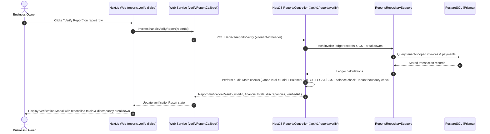

# ollaiBooks AI - Folder Architecture & Implementation Guide

## Local authentication bootstrap

Keep initial account credentials in the ignored `apps/api/.env` file. The project provides `npm --prefix apps/api run auth:provision` to create or update the platform admin and the initial customer workspace. It hashes passwords with bcrypt and activates a one-year Starter subscription managed from the admin console. Customers sign in with email and password; after a successful online sign-in, this device supports password-protected offline POS access for up to seven days, bounded by the subscription end date. The command is safe to rerun; it does not create demo invoices or products.

Run it after PostgreSQL is running, the schema migrations are applied, and Prisma Client is generated:

```powershell
npm --prefix apps/api run prisma:generate
npm --prefix apps/api exec -- prisma migrate deploy
npm --prefix apps/api run auth:provision
```

Do not commit `.env` files. Give the customer the login values from `apps/api/.env` through a private channel.

ollaiBooks AI is an AI-powered multi-tenant billing, order management, customer communication, and voice automation platform built with **Next.js (App Router)**, **NestJS / Node.js**, **Prisma ORM**, and **PostgreSQL**.

---

## 📁 Architecture Overview

This project uses a **Vertical-Slice Modular Monorepo Architecture** where both backend and frontend are organized into self-contained domain modules matching the screenshot pattern:

```text
d:/client projects Ak webflair technologies/Billdesk and ai automate/
├── docker-compose.yml              # PostgreSQL 16 & Redis 7
├── package.json                    # Monorepo workspace root
│
├── apps/
│   ├── api/                        # Node.js + NestJS Backend API
│   │   ├── prisma/
│   │   │   └── schema.prisma       # Full multi-tenant PostgreSQL schema (27+ models)
│   │   └── src/
│   │       ├── main.ts             # Swagger OpenAPI & API bootstrap
│   │       ├── app.module.ts       # Root module
│   │       ├── auth/               # Multi-tenant JWT auth & TenantGuard
│   │       │   ├── auth.controller.ts
│   │       │   ├── auth.service.ts
│   │       │   ├── auth.types.ts
│   │       │   ├── current-user.decorator.ts
│   │       │   └── tenant.guard.ts # Strict cross-tenant isolation guard
│   │       ├── database/           # Prisma service & multi-tenant query helpers
│   │       │   └── prisma.service.ts
│   │       └── modules/            # Vertical-Slice Feature Modules
│   │           ├── reports/        # Reports & Audit Module (matches screenshots!)
│   │           │   ├── index.ts
│   │           │   ├── reports.controller.ts      # REST endpoints (/generate, /verify, /types)
│   │           │   ├── reports.service.ts         # Business logic & verifyReport audit callback
│   │           │   ├── reports.repository.ts      # Database queries
│   │           │   ├── reports.repository-support.ts # Complex aggregations & calculations
│   │           │   ├── reports.types.ts           # Domain interfaces & DTOs
│   │           │   ├── reports.schema.ts          # Zod validation
│   │           │   ├── reports.events.ts          # Domain event emitters
│   │           │   ├── reports.worker.ts          # Asynchronous BullMQ background worker
│   │           │   ├── reports.sync.ts            # Quota & usage sync
│   │           │   ├── reports.lookup.ts          # Available report catalogs
│   │           │   ├── reports.seed.ts            # Test data generator
│   │           │   └── reports.module.ts          # NestJS module binding
│   │           ├── invoices/       # Tax Invoices & Credit Notes
│   │           ├── orders/         # Multi-store Webhook Ingestion & 1-Click Billing
│   │           ├── integrations/   # Shopify, WooCommerce & Custom API credentials
│   │           ├── automations/    # Visual Rules Engine & Worker
│   │           ├── whatsapp/       # Meta Cloud API & AI WhatsApp Assistant
│   │           ├── voice-agent/    # AI Voice Calling Telephony Engine
│   │           ├── customers/      # Unified Customer Directory
│   │           ├── payments/       # Payment Reconciliation
│   │           ├── subscriptions/  # SaaS Pricing Tiers & Metering
│   │           └── dashboard/      # Business Telemetry Overview
│   │
│   └── web/                        # Next.js 14 App Router Frontend
│       ├── tailwind.config.ts
│       ├── next.config.mjs
│       └── src/
│           ├── app/                # Next.js App Router Pages
│           │   ├── layout.tsx
│           │   ├── globals.css     # Clean enterprise SaaS tokens
│           │   ├── page.tsx        # Auto-redirect to /reports
│           │   └── (dashboard)/    # Dashboard layout wrapper
│           │       ├── layout.tsx  # Sidebar + Header
│           │       ├── reports/page.tsx
│           │       ├── invoices/page.tsx
│           │       ├── orders/page.tsx
│           │       ├── payments/page.tsx
│           │       ├── integrations/page.tsx
│           │       ├── automations/page.tsx
│           │       ├── whatsapp/page.tsx
│           │       ├── voice-agent/page.tsx
│           │       ├── subscriptions/page.tsx
│           │       ├── settings/page.tsx
│           │       └── dashboard/page.tsx
│           ├── components/         # Shared UI Primitives
│           │   ├── ui/             # Button, Badge, Card, Dialog
│           │   ├── workspace/      # Table, RowActions, StatusBadge, Header, EmptyState
│           │   └── layout/         # Sidebar, Header
│           ├── lib/
│           │   ├── utils.ts        # formatMoney, formatDate, cn
│           │   └── api-client.ts   # Authenticated API client with tenant headers
│           └── modules/            # Vertical-Slice Frontend Modules (matches screenshots!)
│               ├── reports/        # Reports UI Module
│               │   ├── index.ts
│               │   ├── reports.page.tsx
│               │   ├── reports.workspace.tsx      # Main workspace container
│               │   ├── reports.list.tsx           # Table with actions & verify button
│               │   ├── reports.verify-dialog.tsx  # Modal executing verification callback!
│               │   ├── reports.metrics-panel.tsx  # Totals: Billed, Collected, GST, Outstanding
│               │   ├── reports.form.tsx           # Report export modal
│               │   ├── reports.services.ts        # Client API caller with verifyReportCallback
│               │   ├── reports.hooks.ts           # useReports custom hook
│               │   ├── reports.types.ts           # Frontend TypeScript types
│               │   └── reports.schema.ts          # Zod validation schema
│               ├── invoices/
│               ├── orders/
│               ├── integrations/
│               ├── automations/
│               ├── whatsapp/
│               ├── voice-agent/
│               ├── customers/
│               ├── payments/
│               ├── subscriptions/
│               └── settings/
```

---

## 🔍 How the "Verify Report" Callback Architecture Works

When a user views the Reports workspace and clicks **Verify Report**:



---

## ⚡ High-Scale Multi-Tenant 1,000,000+ Customer Architecture

To support **1,000,000+ customers, orders, and invoices** without website lag or database crashes:

1. **PostgreSQL Composite Indexing**:
   - `Customer`: `@@index([tenantId, isArchived, createdAt(sort: Desc)])`, `@@index([tenantId, name])`, `@@index([tenantId, balanceDue])`
   - `Order`: `@@index([tenantId, orderStatus, createdAt(sort: Desc)])`, `@@index([tenantId, customerId])`, `@@index([tenantId, orderNumber])`
   - `OrderItem`: `@@index([orderId])`, `@@index([productId])` *(prevents full table scans on multi-million line items)*
   - `Invoice`: `@@index([tenantId, status, createdAt(sort: Desc)])`, `@@index([tenantId, customerId])`, `@@index([tenantId, balanceDue])`
   - `InvoiceItem`: `@@index([invoiceId])`, `@@index([productId])`
   - `Payment`: `@@index([tenantId, status, createdAt(sort: Desc)])`, `@@index([tenantId, customerId])`, `@@index([tenantId, paymentDate(sort: Desc)])`
   - `TenantMember`: `@@index([userId])` *(instant sub-millisecond login resolution)*
2. **PostgreSQL Connection Pooling**:
   - Configured via `DATABASE_URL` with `connection_limit=50&pool_timeout=30` to prevent connection exhaustion under high traffic.
3. **Multi-Tenant Hybrid Caching**:
   - Dual-layer cache with **Redis** and in-memory LRU fallback (`CacheService`), auto-namespaced per tenant (`tenant:{tenantId}:{ns}:{key}`).
   - Dashboard aggregations and repeat queries serve in `< 2ms` without hitting PostgreSQL.
4. **Resilience & Crash Prevention**:
   - `AllExceptionsFilter` catches all Prisma constraint errors (P2002, P2025, P2028 timeouts) and unhandled runtime exceptions, returning standard RFC responses instead of terminating the server.
   - Gzip/Brotli payload compression enabled (`compression()`).
   - Body size limits enforced (`10mb`) to block memory-exhaustion attacks.
   - Live health checks at `/api/v1/health` and `/api/v1/health/liveness`.

---

## 🤖 NVIDIA NIM AI Integration (Llama 3.3 70B)

ollaiBooks AI features deep integration with **NVIDIA NIM (Inference Microservices)**:

- **Environment Variables**:
  - `NVIDIA_NIM_API_KEY`: Your NVIDIA API key (from [build.nvidia.com](https://build.nvidia.com/))
  - `NVIDIA_NIM_BASE_URL`: Defaults to `https://integrate.api.nvidia.com/v1` (OpenAI-compatible)
  - `NVIDIA_NIM_MODEL`: `meta/llama-3.3-70b-instruct` (recommended production model)
- **AI Endpoints**:
  - `POST /api/v1/ai/assistant`: Natural language financial copilot strictly bounded to verified tenant aggregate facts.
  - `POST /api/v1/ai/analyze-invoice`: Neural OCR & text bill parser converting raw inputs into structured line items and GST tax totals.
  - `POST /api/v1/ai/draft-communication`: High-converting WhatsApp, SMS, and Email payment reminders and order updates.
  - `POST /api/v1/ai/audit-anomalies`: Automated mathematical reconciliation + AI anomaly detector for tax discrepancies and duplicate payments.
  - `POST /api/v1/ai/voice-script`: Automated voice telephony script generator for customer call agents.
  - `GET /api/v1/ai/status`: NVIDIA NIM provider readiness & model diagnostics.
- **Frontend AI Copilot Widget**:
  - Click the **AI Copilot (NIM)** button in the top navigation header on any screen to ask questions, run audits, or parse bills in real time.
- **Graceful Circuit Breaker**:
  - If `NVIDIA_NIM_API_KEY` is not yet set or external networks are slow, the system automatically uses deterministic rule-based algorithms so the website **never crashes or freezes**.

---

## 🚀 Quick Start Commands

### 1. Start PostgreSQL & Redis
```bash
docker-compose up -d
```

### 2. Run Database Migrations
```bash
cd apps/api
npm install
npx prisma generate
npx prisma migrate dev --name init
```

### 3. Start Backend API (Port 4000)
```bash
npm run start:dev
# Swagger Docs available at: http://localhost:4000/api/docs
```

### 4. Start Next.js Frontend (Port 3000)
```bash
cd ../web
npm install
npm run dev
# Open http://localhost:3000/reports in browser
```

## Voice payment reminder agent

The voice agent is tenant scoped and consent only. The API queues outbound jobs in BullMQ and checks invoice state, current consent, do not call status, tenant local calling hours, and per invoice attempt count immediately before dispatch. Platform callbacks are HMAC signed with timestamp and one time nonce; tenant IDs are resolved from the signed agent configuration. The browser provides settings, campaign previews, call history, consent and DNC management at `/voice-agent`.

### Configure and run locally

1. Configure the API env values in `apps/api/.env.example`: `VOICE_AGENT_WEBHOOK_SECRET` and `VOICE_WORKER_API_KEY` must each be unique random values of at least 32 characters. `VOICE_WORKER_URL` defaults to `http://127.0.0.1:8091`. Set `VOICE_TRANSCRIPT_RETENTION_DAYS` to the transcript/link cleanup period (default 90 days).
2. Configure a real HTTPS payment portal URL in `PAYMENT_LINK_URL_TEMPLATE` and an approved WhatsApp template in `VOICE_PAYMENT_TEMPLATE_NAME`. The template must accept the five variables used by `WhatsAppService`; the URL must authorize the exact tenant and invoice. Payment links fail closed when these are missing. This repository does not include a payment gateway.
3. Apply Prisma migrations and regenerate Prisma Client after stopping any API process that holds the generated Windows query engine file: `npm run db:generate`, then `npm run db:migrate`.
4. In a separate terminal, go to `apps/voice-worker`, create a Python 3.11 virtual environment (`py -3.11 -m venv .venv`, then `.\.venv\Scripts\Activate.ps1`), install the project (`pip install -e .`), and copy `.env.example` to `.env`. Set `WORKER_API_KEY` to the API's `VOICE_WORKER_API_KEY`. The API derives a per-agent HMAC key from `VOICE_AGENT_WEBHOOK_SECRET` and sends it only over this authenticated worker connection. Configure LiveKit URL/API credentials and an outbound SIP trunk ID (or trunk hostname and from-number credentials). LiveKit requires an outbound trunk to place calls. Configure `SARVAM_API_KEY` for the default STT `saaras:v4` and TTS `bulbul:v3`, or choose `VOICE_STT_PROVIDER=ai4bharat-compatible` and/or `VOICE_TTS_PROVIDER=ai4bharat-compatible` with endpoints that implement the OpenAI audio transcription/speech API for your hosted IndicConformer / Indic Parler models. Also configure `VOICE_LLM_API_KEY` and optional OpenAI-compatible base URL/model. The default LLM is a small OpenAI-compatible model.
5. Start API and web as usual, then run two Python terminals from `apps/voice-worker`: `python -m billpilot_voice_worker.gateway` and `python -m billpilot_voice_worker.agent start`. Check `http://127.0.0.1:8091/health` for process status and `/ready` for required API, LiveKit, SIP, STT, TTS and LLM configuration checks.

Do not enable outbound calls until signing secrets, worker credentials, LiveKit, SIP carrier, model, speech credentials, calling consent, and the WhatsApp payment template have been configured and a controlled test call has passed. Actual call recording is not started by this worker, so it only stores transcripts received from the LiveKit session and clears transcript/recording URL references after the configured retention period. Deletion of recordings in an external media provider needs that provider's retention/deletion API to be configured.

AI4Bharat IndicConformer / Indic Parler-TTS can be connected through an OpenAI audio API-compatible hosting endpoint; direct model hosting is external to this repository. Human transfer also needs `HUMAN_TRANSFER_NUMBER` and a configured LiveKit outbound trunk.
